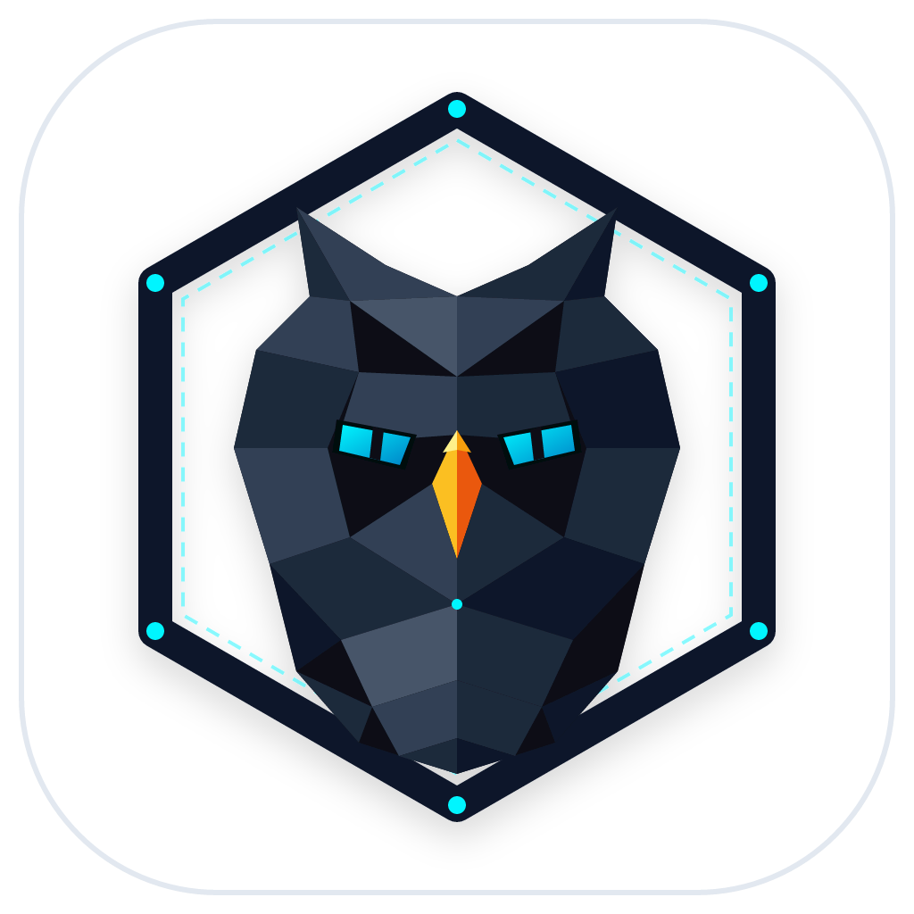
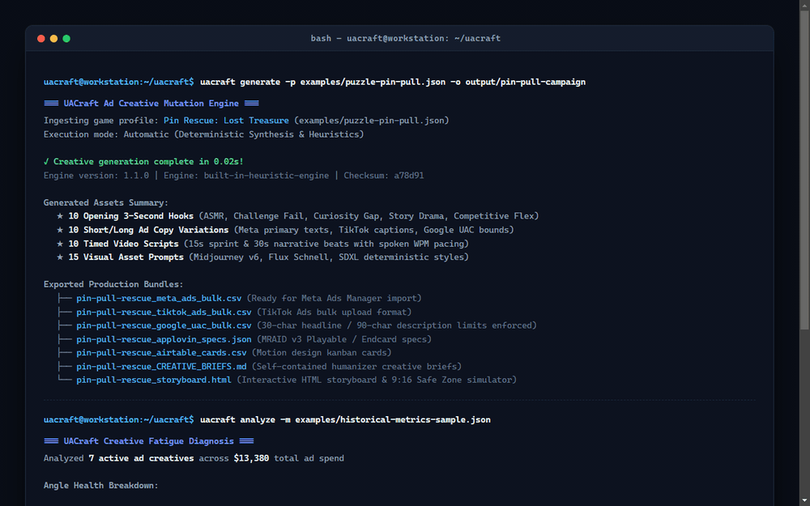
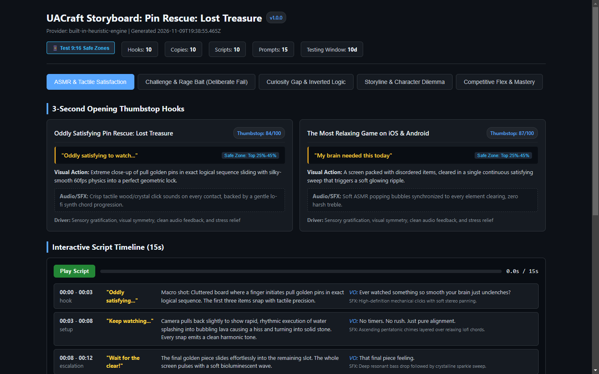
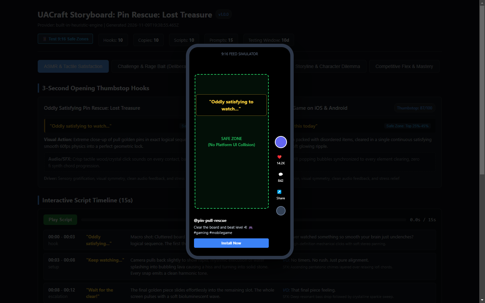
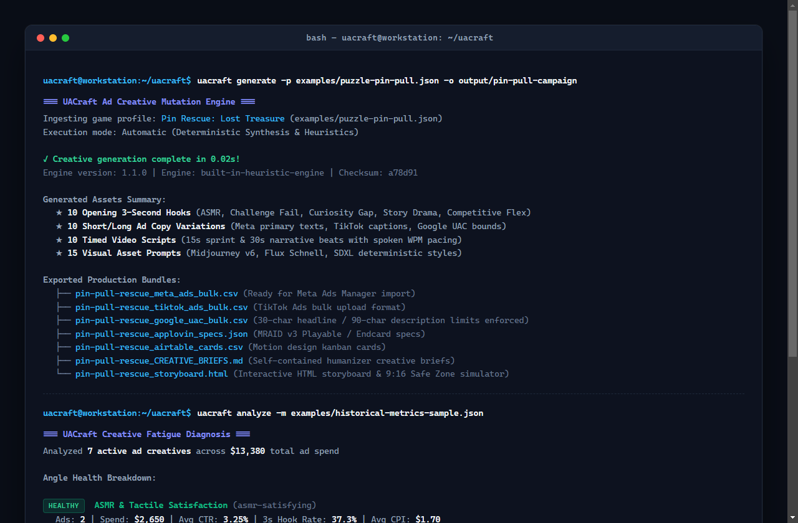

<p align="center">
  
</p>

<h1 align="center">UACraft</h1>

<p align="center">
  <strong>Autonomous Ad Creative, Video Hook, and Copy Mutation Engine for Mobile User Acquisition</strong>
</p>

<p align="center">
  <a href="#features"></a>
  <a href="#installation"></a>
  <a href="#testing"></a>
  <a href="LICENSE"></a>
</p>

UACraft transforms game mechanics profiles and performance metrics into production-ready ad variations, opening video hooks, timed video scripts, concept art prompt recipes, and bulk import files for Meta, TikTok, and Google App Campaigns.

---

## Live Demo & Visual Interfaces

UACraft pairs an automated CLI mutation engine with an interactive standalone HTML storyboard and real-time 9:16 mobile safe zone simulator.

<p align="center">
  
</p>

<p align="center">
  <em>Autonomous generation, creative fatigue diagnosis, interactive angle review, and 9:16 Feed Safe Zone simulation across mobile and desktop viewports.</em>
</p>

### Responsive Multi-Angle Storyboard & Safe Zone Simulator

The generated standalone storyboard adapts dynamically to any screen width, offering responsive inspection on desktop workstations, tablets, and smartphones:

<table width="100%">
  <tr>
    <td width="58%" valign="top">
      <h4 align="center">Interactive Desktop Storyboard</h4>
      
      <p align="center"><sub>Browse hooks, scripts with interactive timed beat players, and image prompts categorized by psychological angle.</sub></p>
    </td>
    <td width="42%" valign="top">
      <h4 align="center">9:16 Feed Safe Zone Simulator</h4>
      
      <p align="center"><sub>Validates text overlays against TikTok, Reels, and Shorts native UI boundaries to prevent occlusion.</sub></p>
    </td>
  </tr>
</table>

### Authentic Terminal Pipeline Run

<p align="center">
  
</p>

---

## The Creative Fatigue Problem in Mobile UA

Mobile games and apps running paid user acquisition on Meta, TikTok, AppLovin, and Google App Campaigns face rapid creative decay:
* Winning ad creatives experience performance fatigue within 7 to 14 days, causing click-through rates (CTR) to drop and cost per install (CPI) to rise.
* To maintain scale, growth teams must test 30 to 50 new creative variations per week across distinct psychological motivations.
* Growth teams routinely spend 15 to 20 hours each week brainstorming hooks, drafting copy variants, and assembling motion design briefs manually.

UACraft automates this pipeline. Given a structured JSON profile of a game's core loop, it generates a full week's testing pipeline across 5 psychological frameworks in seconds.

---

## 5 Psychological Mobile Gaming Frameworks

UACraft decomposes creative strategy into five distinct behavioral triggers:

| Angle | Core Driver | Thumbstop Mechanism | Target Psychology |
| :--- | :--- | :--- | :--- |
| **ASMR & Tactile Satisfaction** | Sensory gratification | Clutter clearing, 60fps physics, tactile audio clicks | Relaxes the mind, triggers visual alignment satisfaction |
| **Challenge & Rage Bait** | Cognitive itch | Deliberate rookie blunder and instant buzzer fail | Triggers ego defiance and the urge to "do it right" |
| **Curiosity Gap & Inverted Logic** | Information gap | Inverted strategy, unexpected shortcut, hidden mechanic | Defies logic expectations, compelling viewers to watch the resolution |
| **Storyline & Character Dilemma** | Emotional empathy | Dire survival stakes, freezing cabin, urgent countdown | Activates protective instincts and makeover interest |
| **Competitive Flex & Mastery** | Status dominance | Split-screen "Noob vs God", x50 combo, leaderboard #1 | Taps into progression desire and high-dexterity mastery |

---

## Installation

```bash
# Clone the repository
git clone https://github.com/alexandrmotologa/uacraft.git
cd uacraft

# Install dependencies
npm install

# Build TypeScript
npm run build

# Link CLI globally (optional)
npm link
```

UACraft requires Node.js 18 or newer.

---

## Quick Start

### 1. Initialize a Game Profile
Scaffold a sample game profile for a puzzle or runner game:

```bash
npx uacraft init game-profile.json --preset puzzle
```

### 2. Generate Creative Assets
Run the generation engine in offline mode (using built-in rule-based synthesis) or using an LLM provider:

```bash
# Offline heuristic mode (zero API keys required)
npx uacraft generate --game-profile game-profile.json --output-dir ./output --offline

# With Google Gemini
export GEMINI_API_KEY="your-gemini-key"
npx uacraft generate --game-profile game-profile.json --provider gemini

# With OpenAI
export OPENAI_API_KEY="your-openai-key"
npx uacraft generate --game-profile game-profile.json --provider openai --model gpt-4o-mini
```

### 3. Review Generated Exports
The command exports production-ready files directly into `./output`:
* `pin-rescue_creative_package.json`: Complete master JSON package.
* `pin-rescue_meta_ads_bulk.csv`: Formatted for Meta Ads Manager bulk upload.
* `pin-rescue_tiktok_ads_bulk.csv`: Formatted for TikTok Ads Manager bulk import.
* `pin-rescue_google_uac_bulk.csv`: Formatted for Google App Campaigns (30-char headline / 90-char description limits).
* `pin-rescue_applovin_specs.json`: Companion endcard specifications for AppLovin and Unity Ads.
* `pin-rescue_airtable_cards.csv`: Ready for Airtable Creative Kanban pipelines.
* `pin-rescue_CREATIVE_BRIEFS.md`: Production briefs for motion designers.
* `pin-rescue_storyboard.html`: Standalone interactive visual storyboard viewer.

### 4. Diagnose Creative Fatigue
Analyze historical ad metrics to identify saturated angles and receive rotation advice:

```bash
npx uacraft analyze --metrics examples/historical-metrics-sample.json
```

---

## CLI Command Reference

### `uacraft init [file]`
Scaffolds a new game profile template.
* `-p, --preset <type>`: Template preset (`puzzle`, `runner`). Default: `puzzle`.
* `-f, --force`: Overwrite existing target file.

### `uacraft generate`
Generates multi-angle ad creative assets.
* `-p, --game-profile <file>`: Path to game profile JSON. Default: `game-profile.json`.
* `-a, --angles <list>`: Comma-separated angle subset (`asmr-satisfying`, `challenge-fail`, `curiosity-gap`, `story-drama`, `competitive-flex`).
* `-c, --count <num>`: Variations per angle. Default: `2`.
* `-d, --durations <list>`: Video script durations in seconds (`15,30`).
* `-o, --output-dir <dir>`: Output folder for generated files. Default: `./output`.
* `-f, --formats <list>`: Target formats (`all`, `meta`, `tiktok`, `google`, `applovin`, `airtable`, `markdown`, `html`).
* `--offline`: Force offline heuristic generation without API calls.
* `--provider <name>`: LLM provider (`gemini`, `openai`, `anthropic`, `custom`).
* `--api-key <key>`: Provider API key.
* `--base-url <url>`: Custom OpenAI-compatible endpoint URL.
* `--model <name>`: Model identifier override.

### `uacraft mutate`
Takes an existing winning script and generates variations through hook swaps and angle cross-pollination.
* `-i, --input <file>`: Input creative package JSON.
* `-a, --angle <angle>`: Target swap angle. Default: `challenge-fail`.
* `-o, --output <file>`: Output path for mutated package.

### `uacraft export`
Converts a previously generated JSON run into specific ad network formats.
* `-i, --input <file>`: Path to creative package JSON.
* `-f, --format <format>`: Format (`meta`, `tiktok`, `google`, `applovin`, `airtable`, `markdown`, `html`, `all`).
* `-o, --output <file>`: Optional custom output file path.

### `uacraft analyze`
Ingests ad performance records and diagnoses angle fatigue.
* `-m, --metrics <file>`: JSON file containing performance metrics.
* `--min-thumbstop <number>`: Minimum acceptable 3s thumbstop rate % (default: 24).
* `--min-ctr <number>`: Minimum acceptable CTR % (default: 1.8).
* `--max-cpi <number>`: Maximum allowable CPI in dollars (default: 2.80).
* `--fatigue-days <number>`: Creative age threshold for warning (default: 12).
* `-o, --output <file>`: Save full diagnosis report to JSON.

### `uacraft preview`
Launches a local preview server for the interactive HTML storyboard.
* `-i, --input <file>`: Creative package JSON or HTML file.
* `-p, --port <number>`: Local server port (default: 3456).
* `--no-open`: Prevents automatic browser launch.

### `uacraft validate`
Validates schemas and enforces mobile ad network character boundaries.
* `-p, --profile <file>`: Validates a game profile against required fields.
* `-k, --package <file>`: Checks headlines (<= 40 chars), primary texts (<= 125 chars), and script pacing (WPM).

### `uacraft matrix`
Generates a full factorial A/B testing matrix with standardized UA naming taxonomy.
* `-i, --input <file>`: Path to creative package JSON.
* `-o, --output <file>`: Output CSV path for batch-rendering sheet.
* `-m, --max-per-angle <num>`: Maximum combinations per angle (default: 12).
* `-r, --ratio <ratio>`: Aspect ratio (`9:16` or `1:1`).

### `uacraft lint`
Audits copy and headlines against Meta and TikTok advertising standards.
* `-k, --package <file>`: Path to creative package JSON to audit.
* `--fix`: Automatically rewrites policy violations, punctuation spam, and text truncation.
* `-o, --output <file>`: Output path for auto-fixed package.

### `uacraft plan`
Calculates mathematical campaign limits to ensure ad sets exit the Meta or TikTok Learning Phase.
* `-b, --budget <number>`: Weekly UA budget in dollars.
* `-c, --cpi <number>`: Target cost per install (CPI) in dollars.
* `-p, --platform <platform>`: Target network (`meta`, `tiktok`, `google`).

### `uacraft teardown`
Deconstructs competitor ad copy and generates counter-angles to out-position them.
* `-t, --ad-text <text>`: Competitor ad transcript or visual scene description.
* `-p, --profile <file>`: Your game profile JSON.
* `-o, --output <file>`: Output path for counter-strategy JSON report.

### `uacraft wizard`
Interactive terminal questionnaire guiding you through 8 questions to scaffold a game profile and generate creative assets on the spot.

---

## Dual Mode Execution

UACraft operates in two modes:

### 1. Built-in Heuristic Synthesis Engine (Offline)
When no API key is set or when `--offline` is passed, UACraft uses a deterministic combinatorial grammar engine. It computes realistic thumbstop scores, constructs 15s and 30s timed beat tables, writes network-compliant copy, and formats Midjourney prompts using domain rules of mobile UA mechanics.

### 2. Multi-Provider LLM Engine
When configured with an API key, UACraft prompts Google Gemini, OpenAI, Anthropic, or an OpenAI-compatible proxy with structured JSON schemas. If an upstream network call fails, the engine automatically falls back to the heuristic synthesis engine.

---

## Ad Network Compatibility

### Meta Ads Manager Bulk Import
* Ad names, primary texts (<= 125 chars), headlines (<= 40 chars), descriptions, and call to action types formatted according to RFC 4180 CSV specifications.
* Automatic ad set segmentation by psychological angle for broad targeting cohorts.

### TikTok Ads Manager Bulk Import
* Ad captions tailored to TikTok specifications (12-100 characters).
* Direct mapping between video script asset IDs and ad creative rows.

### Google App Campaigns (Google UAC) Bulk Import
* Headlines constrained to 30 characters or fewer (up to 5 headlines).
* Descriptions constrained to 90 characters or fewer (up to 5 descriptions).
* Auto-generated ad groups grouped by psychological angle.

### AppLovin & Unity Ads Interactive Endcards
* MRAID v3 compliant companion endcard HTML templates.
* Mobile portrait (9:16) layout with pulsing CTA buttons and star ratings.

### 9:16 Feed Safe Zone Simulator
* Interactive safe zone preview modal inside the HTML storyboard.
* Highlights safe margins (top 20%-45%) to prevent text collisions with native TikTok and Reels UI buttons.

### Airtable & Notion Creative Pipelines
* Exports CSV and JSON formats structured for motion design Kanban boards.
* Includes scene directions, text overlays, voiceover copy, audio SFX instructions, and Midjourney prompt recipes.

---

## Programmatic TypeScript API

UACraft can be integrated into automated CI/CD pipelines or internal UA dashboards:

```typescript
import {
  generateCreativePackage,
  analyzeCreativeFatigue,
  exportMetaAdsCsv,
  exportHtmlStoryboard,
} from "uacraft";

// Generate creative package from game profile
const creativePackage = await generateCreativePackage(gameProfile, {
  angles: ["asmr-satisfying", "challenge-fail", "curiosity-gap"],
  durations: [15, 30],
  offline: true,
});

// Export directly to Meta Ads bulk CSV
const metaCsv = exportMetaAdsCsv(creativePackage);

// Export standalone HTML storyboard
const html = exportHtmlStoryboard(creativePackage);

// Run fatigue analysis on performance logs
const fatigueReport = analyzeCreativeFatigue(performanceMetrics);
console.log(fatigueReport.actionItems);
```

---

## Project Structure

```
uacraft/
├── bin/
│   └── uacraft.js                      # Executable CLI entrypoint
├── src/
│   ├── cli/
│   │   ├── commands/                   # CLI command handlers (generate, analyze, export, etc.)
│   │   └── index.ts                    # Commander program setup
│   ├── core/
│   │   ├── analytics/
│   │   │   ├── budget-planner.ts       # Meta Learning Phase budget allocator
│   │   │   ├── fatigue-analyzer.ts     # Creative decay scoring and angle rotation
│   │   │   └── policy-linter.ts        # Meta/TikTok advertising standards auditor
│   │   ├── angles/                     # The 5 psychological angle strategies
│   │   ├── engine.ts                   # Master creative engine orchestrator
│   │   ├── exporters/                  # Meta, TikTok, Google, AppLovin, Airtable, Markdown, HTML
│   │   ├── generator/                  # Hook, copy, script, matrix, and prompt generators
│   │   ├── llm/                        # Multi-provider client and structured prompts
│   │   └── mutator/                    # Hook swapping and headline mutation
│   ├── types/
│   │   └── index.ts                    # TypeScript interfaces and Zod schemas
│   └── index.ts                        # Programmatic package entrypoint
├── examples/                           # Realistic game profiles and metric samples
├── docs/                               # Architecture, angle theory, and exporter guides
└── tests/                              # Vitest unit, integration, and CLI test suite
```

---

## Testing

Run the test suite with Vitest:

```bash
npm test
```

All 13 test suites verify angle generation, script timing algebra, character bounds, CSV escaping, HTML output, fatigue scoring, budget planning, policy linting, matrix generation, and CLI command execution.

---

## License

MIT License. Authored by Alexandr Motologa.
